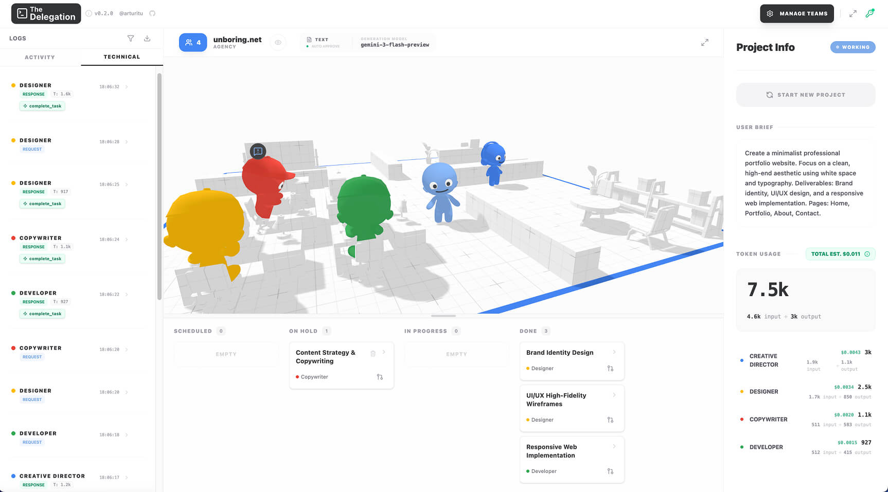

<p align="center">
  
</p>

> [!IMPORTANT]
> Agents run on **Claude**, through the model gateway in `apps/api`. To run them locally you need an **[Anthropic API key](https://platform.claude.com/settings/keys)** set on the gateway (see [Backend](#backend)); an OpenAI key is optional and only used as a backup during Anthropic outages.
<div align="center">
  
</div>

<br/>

## What is The Delegation?

# A no-code 3D playground to explore, design, and interact with Agentic AI systems

This project is designed for **software teams and developers** looking to explore multi-agent collaboration on engineering work (specs, design docs, debugging, code review) in a living 3D office without writing a single line of code.

## Getting Started

Requires [Bun](https://bun.com) 1.3+.

```bash
bun install
bun dev
```

Then open `http://localhost:3000`.

### Repository layout

This is a [Turborepo](https://turborepo.com) monorepo using Bun workspaces:

| Path | What it is |
|---|---|
| `apps/web` | Next.js app (static export) |
| `apps/api` | Hono LLM gateway: holds the provider keys and serves every model call |
| `packages/agents` | Framework-free agent orchestration: the agent loop, tools, prompts and policy |
| `packages/llm` | Model registry, Anthropic and OpenAI adapters, and the fallback router |
| `packages/shared` | API contract types and schemas shared by web and api |

Common tasks run from the repo root through Turborepo: `bun dev`, `bun run build`, `bun run lint`, `bun run typecheck`, `bun run test`. Target one package with `bunx turbo run <task> --filter=web`.

### 3D models

Exported models are sources, not what the browser loads. They live in `apps/web/assets-src/models/`; `bun run assets` (in `apps/web`) builds the optimised copies in `apps/web/public/models/`, which are committed alongside them.

1. Export from Blender with **File > Export > glTF 2.0**:
   - Format: **glTF Binary (.glb)**.
   - Include: the objects you want, plus **Custom Properties** (the office needs them for its points of interest).
   - Mesh: **Apply Modifiers**, **UVs** and **Normals** on; tangents and vertex colours off. **Compression off**: the pipeline compresses (it can still read Draco-compressed files).
   - Material: **Export**; images **Automatic** (PNG or JPEG).
   - Animation: **Skinning** on, shape keys off, actions exported as clips named after `AnimationName` (`Idle`, `Walk`, `Sit_Work`, ...). Missing clips fall back to `Idle`.
   - Office naming the scene relies on: the walkable mesh's name contains `navmesh` (any case) and team-coloured meshes start with `colored`. Points of interest are described by custom properties, not names (see below).
2. Save the `.glb` to `apps/web/assets-src/models/`. A new character also needs an entry in `apps/web/src/simulation/characters/character-models.ts`.
3. Run `bun run assets` in `apps/web` and commit both the source and the output.

The script ([`apps/web/scripts/optimize-models.ts`](apps/web/scripts/optimize-models.ts), using [glTF Transform](https://gltf-transform.dev)) deduplicates, prunes unreferenced data (keeping names, empty POI nodes and extras), welds identical vertices, resamples animations, quantizes normals and skin weights, and applies Meshopt compression (`EXT_meshopt_compression`, decoded in the browser by three's `MeshoptDecoder`). Positions and UVs stay full precision so the scene looks exactly as exported. It always starts from the sources, so it is safe to rerun: unchanged sources give byte-identical output.

#### Points of interest

A point of interest is an empty in the office with a `poi` custom property (exported as glTF node `extras`, which three reads into `userData`). `PoiManager` validates them at load against `OfficePoiExtrasSchema` in [`apps/web/src/simulation/world/office-poi-extras.ts`](apps/web/src/simulation/world/office-poi-extras.ts) and throws, naming the node, if one is malformed. The node's name is free.

| `poi` | Other property | What agents do there | POI id |
|---|---|---|---|
| `spawn` | `slot`: the index of the agent that starts here and returns here when its work is done | stand (`idle`) | `spawn-<slot>` |
| `desk` | `slot`: the index of the agent that works here | sit and work (`sit_work`) | `desk-<slot>` |
| `seat` | `slot`: any number unique among seats | sit (`sit_idle`); the player can pick it | `seat-<slot>` |
| `area` | `area`: a lowercase name (`a-z`, `0-9`, `_`); `boardroom` is where agents with an on-hold task meet | gather facing the centre (`idle`) | `area-<area>` |

Slots are integers. The scene builds every POI id through [`apps/web/src/simulation/world/poi-ids.ts`](apps/web/src/simulation/world/poi-ids.ts), so lookups cannot drift from the parser. `apps/web/test/simulation/world/poi-manager.test.ts` loads `public/models/office.glb` and fails if the navmesh, the boardroom, or a spawn or desk for any agent in the built-in teams is missing or off the navmesh; `character-models.test.ts` does the same for every `AnimationName` clip in each character GLB.

The current office was exported with the POIs encoded in their names only, so `bun scripts/add-poi-extras.ts` (in `apps/web`) stamped the properties onto the source from those names. It edits only the GLB's JSON, leaves nodes that already have a `poi` property alone, and is safe to rerun after a re-export from a Blender file without the custom properties; once the Blender file has them, it is not needed.

## Backend

`apps/api` is the [Hono](https://hono.dev) LLM gateway. The web app sends every model call here; the gateway holds the provider keys, so the browser never sees one. Agents run on Claude, and the gateway fails over to OpenAI when Anthropic is rate limited, overloaded or down.

```bash
cp apps/api/.env.example apps/api/.env      # set ANTHROPIC_API_KEY (OPENAI_API_KEY optional) and ALLOWED_ORIGINS
cp apps/web/.env.example apps/web/.env.local  # set NEXT_PUBLIC_API_URL=http://localhost:8787
bun dev                                     # web on :3000, gateway on :8787
```

| Route | What it does |
|---|---|
| `GET /api/health` | Liveness check; reports whether a Claude key and an OpenAI backup key are configured (never the keys) |
| `POST /api/llm/messages` | Validates the provider-neutral request against `@the-delegation/shared`, serves it through the router (Claude first, OpenAI on outages) and returns the normalised reply, with which provider served it |

- `src/app.ts` is runtime-agnostic (Bun, Workers or Node) and exports `createApp` and `AppType`; `src/index.ts` is the Bun entry.
- Provider adapters, the model registry (models, prices, backups) and the fallback router live in `packages/llm`; the wire contract lives in `packages/shared`.
- The web app reaches the gateway through the typed client in `apps/web/src/lib/api-client.ts` (`hc<AppType>`). It imports only types from `apps/api`, so no server code reaches the bundle.
- CORS allows only the origins in `ALLOWED_ORIGINS`. The per-IP rate limiter is in-memory and meant for development only, and there is no sign-in yet: do not expose the gateway publicly until sign-in and per-user spend caps land.

## Features

### Agentic AI System (v0.2.0)

- **Team Editor (React Flow):** Create your own [multi-agent design patterns](https://developers.googleblog.com/developers-guide-to-multi-agent-patterns-in-adk/) using an interactive node-based interface.
- **5 Software-Development Teams:** Templates to get you started: Feature Squad, Architecture Council, Bug Hunters, Code Review Board and a solo Staff Engineer.
- **Markdown Deliverables:** Each team delivers a Markdown document (spec, design doc, incident write-up, review) that you can review, edit and copy.
- **Per-Agent LLM:** Each agent picks its model. Leads default to Claude Opus 5.5 and team agents to Claude Sonnet 5.5; GPT-6 models are available too, and Claude agents fail over to OpenAI during outages.
- **Cost & Token Tracking:** Real-time estimation of usage costs and token consumption for transparency.
- **PR-style Workflows:** Learn about Pull Request and Review workflows where agents with `human-in-the-loop` properties require your approval to proceed.
- **Guardrails:** Controlled generation with the `Auto-approve output` option, ensuring quality before final asset production.
- **Technical Logs:** Improved visibility into raw LLM traces, tool calls, and structured agent responses.

### Embodied Simulation

- **Hybrid GPU/CPU Architecture:** A high-performance **3D simulation** built with **Three.js WebGPU** where autonomous LLM-powered characters collaborate in a shared physical workspace.
- **Intelligent Pathfinding:** NPCs utilize a NavMesh to navigate the office, finding and claiming specific "Points of Interest" (desks, seats, computers) based on their current task. Navigation is powered by [recast-navigation-js](https://github.com/isaac-mason/recast-navigation-js): characters walk through a Detour crowd, so they steer around each other.
- **Dynamic State Machine:** Characters transition naturally between walking, sitting, working, and talking, with sync'ed 3D speech bubbles and expressions.

### Interactive UI

- **Team Flow Visualizer:** Real-time node-based view of your agent hierarchy and task flows.
- **Simulated PR Reviews:** Interactive modals for reviewing agent proposals, providing feedback, and merging tasks.
- **Real-time 3D Overlay:** Status indicators and interaction menus projected from 3D space into a polished UI.
- **Agent Inspector:** Select any agent to view their "thoughts", mission, and history.
- **Kanban & Action Logs:** Complete transparency into the agency's progress and tool-level interactions.

## Tech Stack Deep Dive

- **Engine:** [Three.js](https://threejs.org/) (WebGPU & TSL) for advanced rendering and compute.
- **App:** [Next.js](https://nextjs.org/) (static export), [shadcn/ui](https://ui.shadcn.com/) and [Tailwind CSS](https://tailwindcss.com/).
- **UI:** [React](https://react.dev/) & [React Flow](https://reactflow.dev/) for node-based team visualization.
- **AI:** [Claude](https://platform.claude.com/docs) is the primary LLM provider, with the [OpenAI API](https://developers.openai.com/api/docs) as an outage backup, both behind a [Hono](https://hono.dev) gateway.
- **State:** [Zustand](https://github.com/pmndrs/zustand) for a unified, reactive store across the 3D world and React UI.
- **Tooling:** [Bun](https://bun.com) workspaces and [Turborepo](https://turborepo.com).
- **3D Assets:** Custom models and animations rigged in [Blender](https://blender.org), using an instanced animation system.

## Roadmap

- **World Building**
    - [ ] **Office/3D Space Editor:** Drag-and-drop workspace layout and POI customization.
    - [ ] **Dynamic Environment:** Real-time prop generation and environment modification by agents.
- **Advanced Interactions**
    - [ ] **Advanced Embodied AI:** Deeper integration between agent reasoning and physical 3D world actions.
    - [ ] **Enhanced Animations:** Richer character expressions and more fluid, context-aware animations.
    - [ ] **Human-Agent Spatial Interaction:** Direct collaboration and richer multi-party interactions in the 3D office.
    - [ ] **Inter-Agent Knowledge Sharing:** Long-term memory for agent teams across projects.
- **Refinement**
    - [ ] **Architecture Decoupling:** Further separation of core logic from the simulation environment.
    - [ ] **UX/UI Overhaul:** Unified CSS styling based on "The Delegation" brand identity.

## Developer Note

This release (**v0.2.0**) was developed entirely using **Google Antigravity** as the primary IDE and powered by **Gemini 3 Flash**.

## License & IP

This project follows a dual-licensing model:

- **Source Code (MIT):** All logic, shaders, and UI code are free to use, modify, and distribute.
- **3D Models & Assets (CC BY-NC 4.0):** The custom 3D office and character models are Copyright © 2026 **Arturo Paracuellos ([unboring.net](https://unboring.net))**. They are free for personal and educational use but _cannot_ be used for commercial purposes without permission.

Developed with ❤️ by [Arturo Paracuellos](https://unboring.net)
